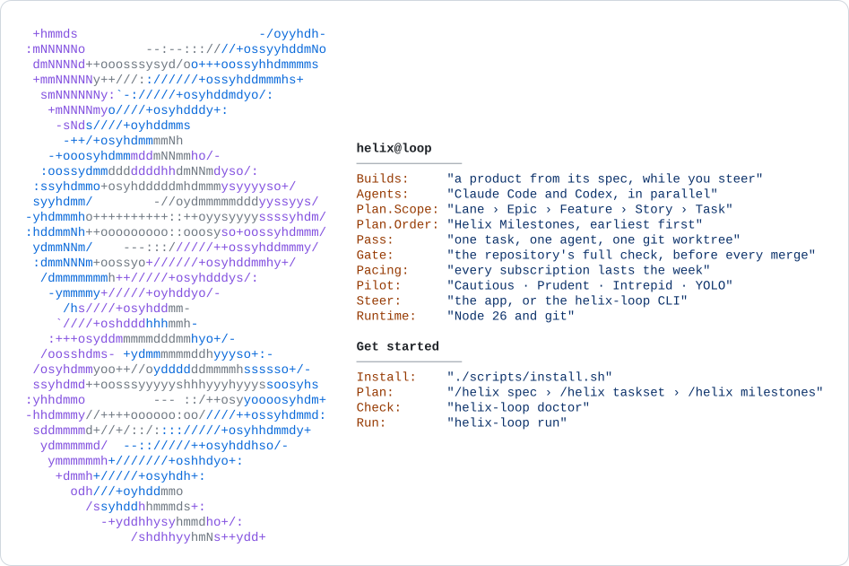

# Helix Loop

Build a product from a spec with headless coding agents, Claude Code and Codex, in a loop you steer.

You write a spec with numbered requirements and break it into a TaskSet: lanes (repositories), epics (outcomes), features (capabilities), user stories (needs) and tasks small enough for one agent pass each.
Then you order the delivery as milestones, outcomes you can demo, from a walking skeleton to the full product.
Helix Loop runs the agents in parallel on those tasks, earliest milestone first, each in its own git worktree, merges only the work that passes each repository's full check, and paces the agents so their subscriptions last the week.
You steer from the app or the command line: the human tasks only you can do, the failures that need a decision, the fixes Helix proposes.

## Install

Helix Loop needs Node 26 or later, git, and Claude Code, Codex or both, signed in with their subscriptions.

```sh
git clone <this repository> helix-loop
cd helix-loop
./scripts/install.sh
```

The installer checks Node and git, installs the `helix-loop` command for your user, and then offers to install the Helix skill globally or into one project.
Install the skill later, or somewhere else, with `helix-loop skill install`.

## Start

```sh
cd my-product
helix-loop init            # .helix/: the config, the build prompt, the repos to build
# In Claude Code or Codex here: /helix spec, then /helix taskset (the Helix skill)
helix-loop taskset import <the TaskSet folder> --apply
# Then /helix milestones: the delivery order, which it applies with helix-loop milestones apply
helix-loop doctor          # the machine and the project, checked
helix-loop app --open      # the control room in the browser
helix-loop run             # the loop
```

[Getting started](docs/getting-started.md) walks through it.

## Documentation

- [Getting started](docs/getting-started.md): install, start a project, write the spec, the TaskSet and the milestones, run the loop.
- [Concepts](docs/concepts.md): Lane › Epic › Feature › Story › Task, milestones and placeholders, revisions, passes and gates, the two finish dates, fixes and what they can do, pilot mode, Helix and its monitor.
- [CLI reference](docs/cli.md): every command, generated from the commands themselves; `helix-loop <command> --help` says the same.
- [The app](docs/app.md): Home, the Map, Live, Helix, the metrics and Settings, and the command for each action.
- [Project layout](docs/project-layout.md): what is in `.helix/`, and what to commit.
- [Configuration](docs/configuration.md): `.helix/config.yaml`, section by section.
- [The Helix skill](docs/skill.md): writing a spec, a TaskSet and its milestones with Claude Code or Codex.
- [Migrating](docs/migrating.md): a control plane from before `.helix/`, and a version 1 TaskSet.

## Developing Helix Loop

```sh
npm ci
npm run check      # typecheck, every test (with fake agents, never the real ones), and the CLI docs
npm run docs       # regenerate docs/cli.md after changing a command
npm run build      # dist/, what an install runs; npm pack builds it on its own
```

From a checkout, `node bin/helix-loop.ts` runs the TypeScript directly.
